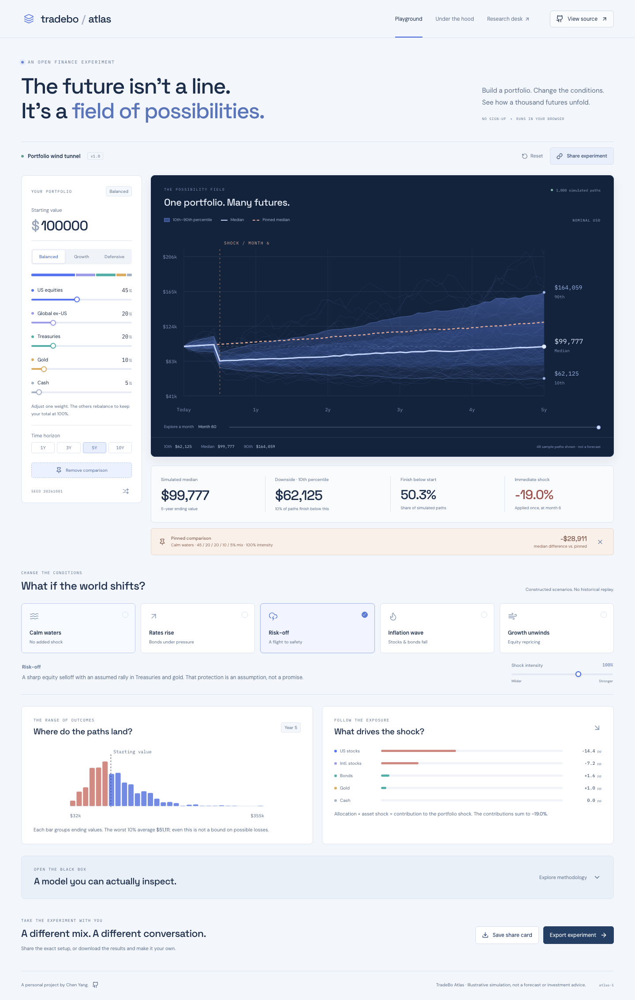
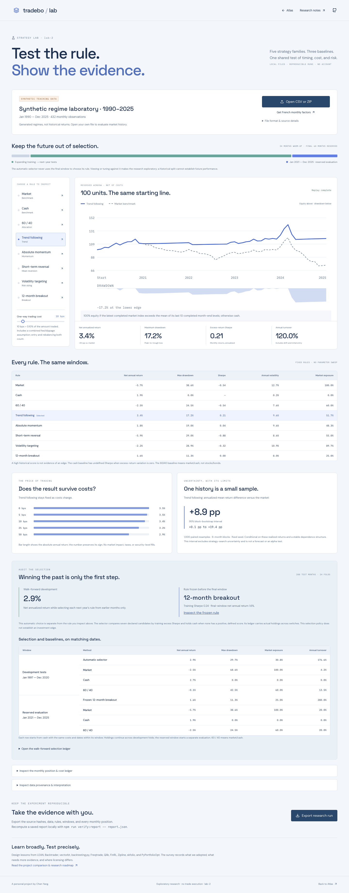

# TradeBo

An open-source workspace for portfolio simulation and investment-strategy research.

A personal project by [Chen Yang](https://github.com/Chencharl).

[**Open Atlas**](https://chencharl.github.io/Trade_bo/) · [**Open Strategy Lab**](https://chencharl.github.io/Trade_bo/#lab) · [Research roadmap](docs/STRATEGY_RESEARCH.md)

## What we have built

- **Atlas:** a browser-based portfolio simulator for comparing allocations and market scenarios.
- **Strategy Lab:** a browser-based tool for evaluating eight monthly market/cash rules, including trading costs, risk metrics, and walk-forward selection. It supports local data imports and research exports.
- **Research desk:** a local Python-backed workspace for reviewing holdings, company information, and paper trade plans.

Atlas and Strategy Lab work without an account. Their default data and assumptions are illustrative; Strategy Lab can also evaluate imported return histories. The project does not execute trades.

## What we are building toward

One research workspace where investors and developers can compare strategies on consistent data, understand their risks and costs, and reproduce the results.

The next priorities are broader strategy coverage, better historical-data support, and a shared evaluation framework across portfolio and strategy research. The [roadmap](docs/STRATEGY_RESEARCH.md#method-roadmap) separates implemented methods from proposed work.

<details>
<summary>Product previews</summary>

### Atlas



### Strategy Lab



</details>

## Run locally

Requires Node.js 22.12 or newer.

```bash
git clone https://github.com/Chencharl/Trade_bo.git
cd Trade_bo
npm ci
npm run dev
```

The [research desk guide](docs/RESEARCH_DESK.md) covers the optional Python backend.

## Documentation

- [Atlas model](docs/ATLAS_MODEL.md)
- [Strategy Lab calculations and data](docs/STRATEGY_LAB.md)
- [Project comparison and roadmap](docs/STRATEGY_RESEARCH.md)
- [Development and testing](CONTRIBUTING.md)
- [Deployment workflow](.github/workflows/pages.yml)

[MIT license](LICENSE) · [Third-party notices](docs/THIRD_PARTY.md)
