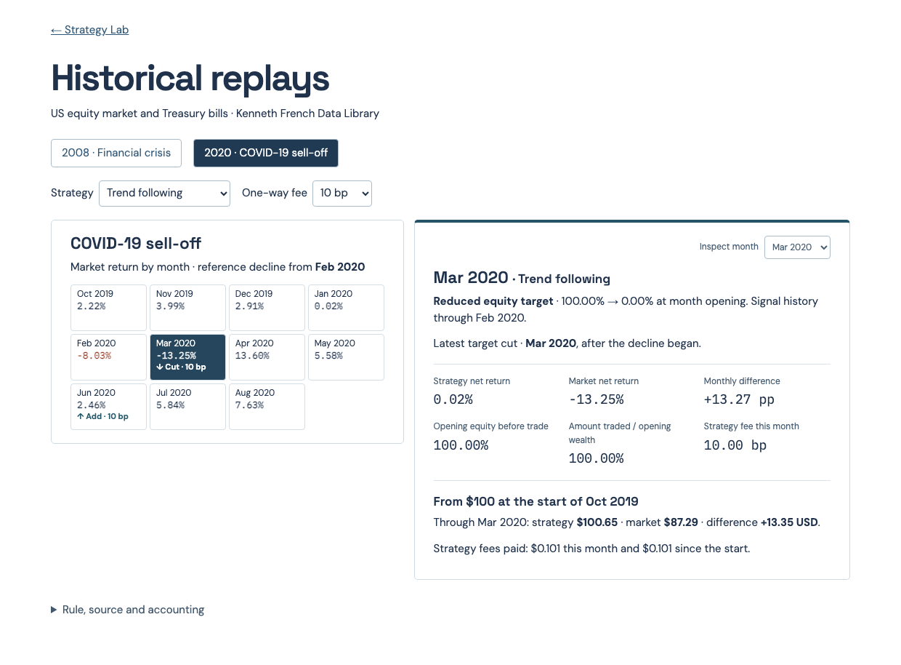

# Historical crisis replays

Open the [2008 financial crisis](https://chencharl.github.io/Trade_bo/#lab-history-2008) or [2020 COVID-19 sell-off](https://chencharl.github.io/Trade_bo/#lab-history-2020). Select a month for its opening decision, latest target cut, trading fee and net return against holding the US market. The address includes the selected rule, fee and month when you change them.



## Data and timing

The browser fetches a pinned copy of the September 2026 Fama/French 3 Research Factors monthly CSV. Its bytes matched the CSV in the official ZIP retrieved on November 25, 2026. The browser checks all 1,203 normalized rows against the recorded SHA-256 before showing results. An archived local CSV or ZIP can be opened if the download fails. The market sleeve earns Mkt−RF + RF and the cash sleeve earns RF. These are revised monthly research data. Historical publication times and intramonth fills are unavailable. [Official definitions](https://mba.tuck.dartmouth.edu/pages/faculty/ken.french/Data_Library/f-f_factors.html) · [Fixed CSV](https://raw.githubusercontent.com/callumtoc/stat40920-group-project/e6878880db0e5a2aea34787f30a34b8a778ed133/data/raw/F-F_Research_Data_Factors.csv)

| Episode           | First displayed month | Reference decline month | Last displayed month |
| ----------------- | --------------------- | ----------------------- | -------------------- |
| Financial crisis  | Jul 2007              | Nov 2007                | Jun 2009             |
| COVID-19 sell-off | Oct 2019              | Feb 2020                | Aug 2020             |

The reference months are retrospective anchors used only to label timing. Each rule sees data through the previous month. “Reduced” compares the new target with the previous target. The transaction also accounts for the change in the actual equity weight after last month's returns. A constant 60% target can therefore incur a fee. The latest cut includes 24 months of prior holdings history and stops at the selected month.

Strategy and Market carry holdings into the window. Each is scaled to $100 immediately before the first displayed month. The fee equals opening wealth × actual turnover × one-way fee rate. Monthly difference subtracts Market's net return from the strategy's net return, in percentage points. The dollar difference subtracts the two compounded ending values. The assumptions are proportional costs, monthly execution, and no taxes. [Accounting contract](STRATEGY_LAB.md)

## Trend following at 10 bp one way

| Month    | Opening equity action | Strategy net | Market net | Difference (pp) | Actual fee (bp of opening wealth) |
| -------- | --------------------- | -----------: | ---------: | --------------: | --------------------------------: |
| Nov 2007 | Held 100%             |       −4.46% |     −4.46% |            0.00 |                                 0 |
| Jan 2008 | Cut to 0%             |       +0.11% |     −6.12% |           +6.23 |                                10 |
| Oct 2008 | Held 0%               |       +0.08% |    −17.12% |          +17.20 |                                 0 |
| Feb 2020 | Held 100%             |       −8.03% |     −8.03% |            0.00 |                                 0 |
| Mar 2020 | Cut to 0%             |       +0.02% |    −13.25% |          +13.27 |                                10 |
| Apr 2020 | Held 0%               |        0.00% |    +13.60% |          −13.60 |                                 0 |

By June 2009 each initial $100 had become $100.22 for Trend and $65.34 for Market. By August 2020 the corresponding values were $117.37 and $122.20. These two inspected events show a reaction after the initial losses and a cost to missing the rebound. Estimating warning precision requires additional periods and false-alarm counts.

## Reproduce the checks

With dependencies installed and the fixed CSV or ZIP saved locally, run:

```sh
npm run verify:crises -- /path/to/F-F_Research_Data_Factors.csv
npm run bench:lab -- /path/to/F-F_Research_Data_Factors.csv
TRADEBO_HISTORY_FILE=/path/to/F-F_Research_Data_Factors.csv npm run test:e2e -- crises.spec.ts
```

The independent Python verifier uses 50-digit decimal arithmetic and up to four CPU processes. It checks eight rules at six fee levels in both windows, covering 96 scenarios and 1,680 monthly records. Opening signals, actions and cut dates matched. The largest absolute numeric difference across the reported fields was 1.09 × 10⁻¹³. The normalized monthly input SHA-256 is `bda5eb94cfe0d19a02842e08907305c190f7270edf70c442bcbc12f5d9a9cf24`.

Walk-forward selection reuses each candidate's expanding history and updates sample variance in one pass. On an Apple M5 Max with Node 26.5.0, 25 warm full evaluations of this snapshot took a median 6.0 ms (90th percentile 7.4 ms), compared with 68.9 ms (90th percentile 70.9 ms) on v1.4.0. The serialized results for all eight inspected rules at 0, 10 and 100 bp matched byte for byte, with SHA-256 `cbf01a3b46e9d54f7da8d4af2f504d47fc33b5d561923f86d87b81fe6ac3d643`. The benchmark measures calculation time on this machine. The signal rules and their timing are the same.
