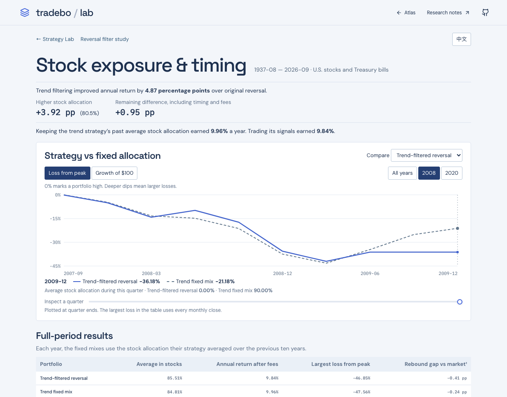

# Exposure and timing

Protocol `exposure-controls-1`. Use the snapshot, 90 test folds, 1,070 test months and 10 bp one-way fee from the [reversal filter study](STRATEGY_REVERSAL_FILTERS.md). Its trend-minus-original net CAGR difference is already known.

## Controls fixed before evaluation

For each test fold, compute two separate average opening equity targets over the preceding 120 months, one for original reversal and one for trend-gated reversal. Replay the historical trend gate sequentially during the initial calibration decade, starting from the raw target in its first month. From the first test opening onward use the published strategy's actual target history. Each control holds its training mean fixed for the next test fold and rebalances monthly to that target after holdings drift. Use the available two months in the last fold. All five portfolios start with $100 in cash, pay entry costs and carry holdings and wealth across folds.

Let T and O be the net annualized compound returns of trend-filtered and original reversal, and Cₜ and Cₒ those of their respective lagged fixed-allocation controls. The allocation component is Cₜ − Cₒ. The remaining component is (T − Cₜ) − (O − Cₒ). Their sum is exactly T − O in annual percentage points. Show both individual strategy-minus-control gaps. Recalculate the same difference of gaps before fees to identify the contribution of differential fee drag. The residual includes timing, compounding and differences between estimated and realized exposure. It cannot identify timing skill causally.

Use the maximum drawdown at monthly closes including starting capital. Rebound comparisons average each portfolio's net monthly return minus Market across the same retrospectively labeled trough-to-recovery months used in the previous study. The capital paths already include these returns. Charts sample the monthly simulation at calendar quarter ends, plus the common starting observation and sample end. Loss from peak at a plotted date uses all monthly closes through that date.

## September 2026 snapshot results

The fixed mixes explain 3.9234 of the 4.8718 annual percentage points (80.5%). The remaining 0.9484 points reflect the difference between the strategies’ gaps to their own controls. Original reversal trailed its mix by 1.0608 points per year. Trend-filtered reversal trailed its mix by 0.1123 points. Of the 0.9484-point residual, 0.1881 points come from lower relative fee drag and 0.7603 points persist before fees. The estimated control does not match each test period's realized exposure exactly.

| Portfolio               | Average opening equity | Net CAGR | Maximum monthly-close drawdown | Average rebound-month gap to Market |
| ----------------------- | ---------------------: | -------: | -----------------------------: | ----------------------------------: |
| Trend-filtered reversal |                 85.51% |    9.84% |                         46.85% |                            −0.41 pp |
| Trend fixed mix         |                 84.81% |    9.96% |                         47.56% |                            −0.24 pp |
| Original reversal       |                 30.65% |    4.97% |                         44.09% |                            −0.76 pp |
| Original fixed mix      |                 31.84% |    6.03% |                         22.78% |                            −1.03 pp |
| Buy and hold            |                   100% |   10.88% |                         50.31% |                             0.00 pp |

Dates are August 1937 through September 2026. The 314 rebound months are labeled after the fact and enter all five portfolios’ full-period wealth. Relative to its fixed mix, trend-filtered reversal cut the largest loss by 0.72 points, gave up 0.11 annual points, and lagged by 0.17 points per rebound month. The original study and this extension reuse the same U.S. history.

[](https://chencharl.github.io/Trade_bo/#lab-exposure)

Test how often the residual occurs under [10,000 matched random trade schedules](STRATEGY_TIMING_TEST.md).

## Reproduction

Use the September 2026 snapshot from the [archived CSV](https://raw.githubusercontent.com/callumtoc/stat40920-group-project/e6878880db0e5a2aea34787f30a34b8a778ed133/data/raw/F-F_Research_Data_Factors.csv). The [Kenneth French Data Library](https://mba.tuck.dartmouth.edu/pages/faculty/ken.french/Data_Library/f-f_factors.html) documents the U.S. market and risk-free inputs. The exhibit uses their monthly stock market total return (market excess return plus the risk-free rate) and monthly risk-free return. Simulated fills use month-boundary targets with no intramonth price information. The revised historical snapshot cannot establish what a trader's contemporary data release showed.

```bash
npm ci
node --import tsx scripts/exposure-controls.mjs /path/to/archived.csv > /tmp/exposure-controls.json
npm run verify:exposure -- /path/to/archived.csv
```

The chart also shows each portfolio’s average opening stock allocation for the months ending at the selected quarter. The first plotted point is starting capital and has no holding period.

The independent Python check uses 50-digit decimal arithmetic and compares each portfolio, training mean, test-period return and plotted value with the [published report](../public/research/exposure-controls.json). The JavaScript artifact must also regenerate byte for byte. The protocol was recorded in commit `49a09e8` before computing these control results.
