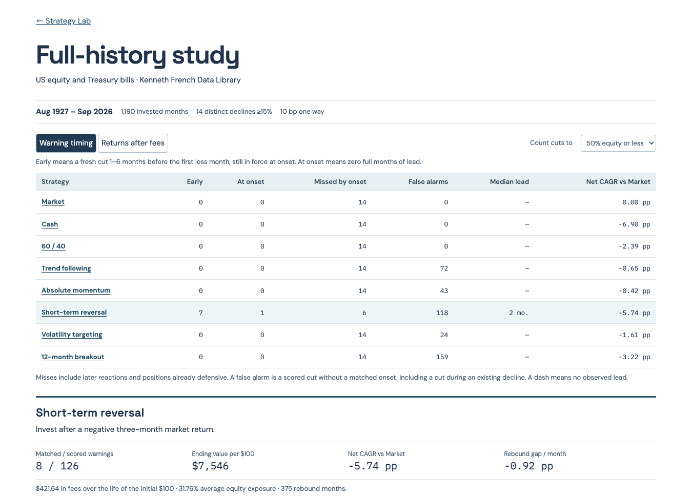

# Full-history warning study

Protocol `history-events-1`. Compare the eight existing fixed rules on the pinned September 2026 French snapshot, without refitting rules or selecting a winner. The [source definitions](https://mba.tuck.dartmouth.edu/pages/faculty/ken.french/Data_Library/f-f_factors.html) and [snapshot fingerprint](STRATEGY_CRISIS_REPLAYS.md) identify the market and cash series.

## Prespecified scoring

- Use every source month. The first 13 months supply the longest signal lookback. All portfolios start together in cash with $100, pay their initial trades, and compound continuously to the last month. Targets use completed months only. Market is the same-date fully invested benchmark.
- A decline starts in the first month below the previous gross-market high. Count it once if month-end wealth eventually falls at least 15% below that high. End the episode on the first recovery to the high. Record onset, first breach, deepest trough and recovery. A long underwater spell can contain several sell-offs. An unconfirmed open spell has an unresolved onset.
- Score two prespecified thresholds separately. A warning is a fresh opening target crossing from above 50% to at most 50%, or, in the partial-cut analysis, from 100% to below 100%. Consecutive defensive months produce one warning. Initial allocation creates no warning. Fixed Market, Cash and 60/40 have no timing signals.
- Match a cut to the first unmatched qualifying onset within zero to six opening-month intervals while the strategy remains on the defensive side. Each cut and event can match at most once. One to six months earns advance credit. Zero is shown separately. The median uses strictly positive matched leads. A cut after onset cannot earn credit for that episode, even if it precedes the 15% breach. “Missed by onset” includes reactive cuts and protection already in place outside this window.
- Allow six observable prior signal months before scoring an onset. An unmatched cut with incomplete six-month follow-up, or a still-unconfirmed onset in its horizon at the data boundary, is unscored. Exclude cuts linked to left-truncated onsets from false alarms. A scored cut without a match is a false alarm under this onset-timing question. It can still reduce a subsequent loss within an ongoing episode.
- Use 10 bp one way on absolute trades from drifted holdings. Report net CAGR, its arithmetic difference from Market in percentage points, end wealth per $100, max drawdown and the difference in CAGR from rerunning the identical targets at zero fee. Rebound months extend from the month after each observed trough through recovery inclusive (through sample end for an open event). Report the arithmetic mean monthly net gap on those dates and event-specific compounded gaps. All those returns already enter full-period wealth. Recovery dates are retrospective labels.
- This uses revised monthly aggregates. Timing is relative to modeled monthly openings and retrospectively identified episodes. Lead times exclude intramonth information. A century of observations in one market still yields a limited number of distinct events.

## September 2026 snapshot results

The source spans July 1926 through September 2026. All eight portfolios share 1,190 months, August 1927 through September 2026. There are 14 qualifying episodes and 375 rebound months. September 2026 began an unresolved underwater spell. [Interactive study](https://chencharl.github.io/Trade_bo/#lab-full-history) · [Download the calculated results](https://chencharl.github.io/Trade_bo/research/full-history.json)

| Rule                    | Early | At onset | Missed by onset | False alarms | Median lead, months | Net CAGR | CAGR vs Market, pp | Fee drag, annual pp | Mean monthly rebound gap, pp |
| ----------------------- | ----: | -------: | --------------: | -----------: | ------------------: | -------: | -----------------: | ------------------: | ---------------------------: |
| Market                  |     0 |        0 |              14 |            0 |                   — |   10.19% |               0.00 |               0.001 |                         0.00 |
| Cash                    |     0 |        0 |              14 |            0 |                   — |    3.29% |              −6.90 |               0.000 |                        −1.81 |
| 60 / 40 market and cash |     0 |        0 |              14 |            0 |                   — |    7.81% |              −2.39 |               0.013 |                        −0.72 |
| Trend following         |     0 |        0 |              14 |           72 |                   — |    9.54% |              −0.65 |               0.163 |                        −1.16 |
| Absolute momentum       |     0 |        0 |              14 |           43 |                   — |    9.77% |              −0.42 |               0.096 |                        −1.12 |
| Short-term reversal     |     7 |        1 |               6 |          118 |                   2 |    4.46% |              −5.74 |               0.268 |                        −0.92 |
| Volatility targeting    |     0 |        0 |              14 |           24 |                   — |    8.58% |              −1.61 |               0.047 |                        −0.90 |
| 12-month breakout       |     0 |        0 |              14 |          159 |                   — |    6.97% |              −3.22 |               0.347 |                        −1.41 |

The table uses fresh cuts to 50% equity or less. Allowing any exit from full equity changes the volatility rule to 28 false alarms. The event hits and median leads are identical under both definitions. Trend, short-term reversal and breakout each had one unscored end-of-sample cut. The three static allocations serve as controls and cannot generate a fresh cut under either definition.

Short-term reversal averaged 31.76% equity exposure. Eight of its 126 scored cuts matched by onset (6.35%), including one zero-lead match. In the six missed episodes it was already defensive outside the six-month window. Trend following reacted after onset by the first 15% breach in 11 of the 14 episodes. Its maximum monthly-close drawdown was 43.1%, compared with 83.7% for holding Market. Smaller drawdowns and advance warnings measure different outcomes.



The [rolling reversal filter study](STRATEGY_REVERSAL_FILTERS.md) profiles all 118 original false alarms and tests three gates against same-date reversal and Market portfolios.

## Reproduce

Install dependencies with `npm ci`, then obtain the [pinned French CSV](https://raw.githubusercontent.com/callumtoc/stat40920-group-project/e6878880db0e5a2aea34787f30a34b8a778ed133/data/raw/F-F_Research_Data_Factors.csv). The original source file stays outside the repository. The published JSON contains the derived results, including event dates, individual warning classifications and false-alarm dates.

```sh
node --import tsx scripts/full-history.mjs /path/to/F-F_Research_Data_Factors.csv > full-history-local.json
npm run verify:history -- /path/to/F-F_Research_Data_Factors.csv
```

The verifier checks that regeneration produces the published JSON byte for byte. It independently reconstructs the eight target and holdings paths, high-water spells, matched cuts, false alarms, censored dates, fees, drawdowns and rebound returns using 50-digit decimal arithmetic. The canonical SHA-256 of all normalized input rows is `bda5eb94cfe0d19a02842e08907305c190f7270edf70c442bcbc12f5d9a9cf24`. The six-month forward-window diagnostic on the reserved sample keeps its separate [risk-audit-1 definition](STRATEGY_RISK.md).
