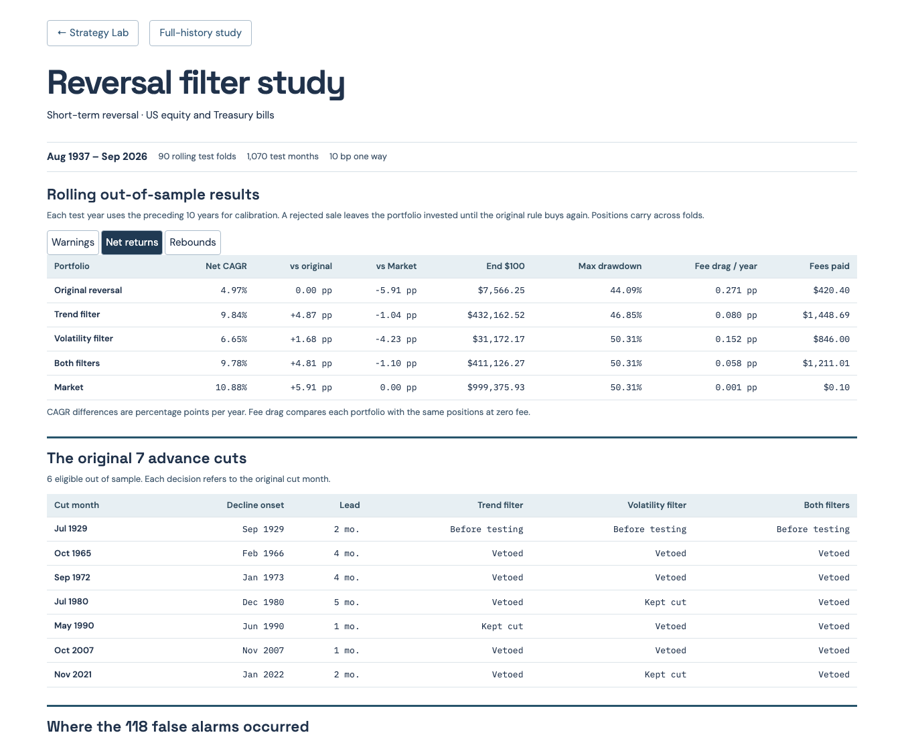

# Short-term reversal filter study

Protocol `reversal-filters-1`. Use the identical French snapshot, monthly accounting, 15% independent drawdown episodes and opening-to-onset scoring from the [full-history study](STRATEGY_FULL_HISTORY.md). Its seven early matches and 118 false alarms are known. This historical walk-forward exercise is exploratory. The rules below precede the filter results.

## Frozen protocol

- Profile every original false alarm using only information available through the preceding month under the modeled lag. Record the prior three-month compounded market return, close versus its ten-month mean, trailing twelve-month annualized sample volatility and drawdown from the prior high. Use fixed descriptive volatility bands below 10%, 10% to below 20%, and 20% or above. Provide the same conditions for matched cuts so counts have a reference. Censored cuts stay outside these counts.
- Compare five continuous portfolios: unfiltered reversal, Market, trend-gated reversal, volatility-gated reversal, and the intersection of both gates. No winner selection. A gate evaluates only at a fresh original 100%-to-cash cut. If it vetoes the sale, hold equity until the original next enters equity. Never initiate a delayed sale or change an existing spell at a fold boundary. All variants take original equity entries.
- Trend admits a cut when the last completed market level is at or below the mean of ten completed month-end levels (the existing Trend rule's cash state). Volatility admits a cut when the lagged twelve-month annualized sample standard deviation is strictly above the rolling training median. The combined gate requires both. Nothing is fitted to crash dates or outcome labels.
- After the existing 13-month common warmup, use 120 consecutive monthly opening observations for calibration, then test the next 12 months. Roll both windows by 12 months, refit the median using only the preceding 120 opening volatility readings, and keep it fixed throughout the test fold. Include the last partial test fold. At the first test opening, an inherited original cash spell starts in cash; a fresh cut uses the gate. All portfolios start from $100 in cash and pay actual entry costs. Carry holdings and wealth continuously across later folds.
- Keep the full-sample descriptive counts separate from out-of-sample (OOS) results. Show all seven original advances with their cut and onset dates, original leads and each filter's actual OOS decision. A training-only date cannot count as a retained or lost OOS hit. Repeat the existing six-month outcome scoring on stitched OOS targets, including its left and right eligibility rules.
- Report OOS false alarms, strictly early and onset hits, missed events and precision; net CAGR, gaps to both benchmarks, ending wealth, max drawdown, average equity exposure, paid fees and annualized fee drag. Apply 10 bp one way to drift-adjusted trades. Count all OOS rebound months from the month after an observed crash trough through recovery, including the overlap with an episode that began before OOS. Show mean monthly net rebound gaps to both benchmarks. These returns already enter ending wealth. Record calendar boundaries, per-fold cutoffs and period returns from the continuous ledgers.

## Findings

The full-history ledger contains 127 original cuts: 118 false alarms, seven strictly early matches, one onset-month match and one right-censored cut. At the preceding close, 82 of the 118 false alarms were above the ten-month mean. Six of the seven early matches were also above it. Volatility was below 10% for 12 false alarms, between 10% and 20% for 77 and at least 20% for 29. None of the seven early hits had volatility of at least 20%. The fixed bands describe conditions, while the rolling filter compares volatility with its own fold cutoff. Prior drawdown was below 5% for 57 false alarms, between 5% and 15% for 22 and at least 15% for 39. [Explore individual cuts](https://chencharl.github.io/Trade_bo/#lab-reversal-filters)

The 1,070 tradable OOS months run from August 1937 to September 2026 in 89 full test folds and a final two-month fold. All portfolios start together and use the same 13 eligible OOS decline onsets. Eleven original false alarms and the 1929 advance date predate the test. The unfiltered OOS rule had 107 false alarms, six strictly early hits, one onset-month hit and one unscored cut.

| Portfolio         | False alarms | Early | At onset | Precision | Net CAGR | vs original (pp/yr) | vs Market (pp/yr) | Rebound vs Market (pp/mo) | Equity exposure | Max drawdown |
| ----------------- | -----------: | ----: | -------: | --------: | -------: | ------------------: | ----------------: | ------------------------: | --------------: | -----------: |
| Original reversal |          107 |     6 |        1 |     6.14% |    4.97% |                0.00 |             −5.91 |                     −0.76 |          30.65% |       44.09% |
| Trend filter      |           31 |     1 |        0 |     3.13% |    9.84% |               +4.87 |             −1.04 |                     −0.41 |          85.51% |       46.85% |
| Volatility filter |           60 |     2 |        1 |     4.76% |    6.65% |               +1.68 |             −4.23 |                     −0.70 |          59.63% |       50.31% |
| Both filters      |           23 |     0 |        0 |     0.00% |    9.78% |               +4.81 |             −1.10 |                     −0.33 |          88.60% |       50.31% |
| Market            |            0 |     0 |        0 |         — |   10.88% |               +5.91 |              0.00 |                      0.00 |         100.00% |       50.31% |

Trend retained the May 1990 sale before the June 1990 onset. Volatility retained July 1980 before December 1980 and November 2021 before January 2022. Both together retained none. The net-return improvements accompany higher average equity exposure, lower annualized fee drag and greater rebound participation. Across 314 OOS rebound months the three gates gained 0.35, 0.07 and 0.43 percentage points per month over original reversal respectively. Each still lagged Market on these dates. Their maximum drawdowns were also deeper than the original strategy's. Only six eligible advance cuts make retention estimates sensitive to individual episodes.



## Reproduce

With `npm ci` and the [pinned French CSV](https://raw.githubusercontent.com/callumtoc/stat40920-group-project/e6878880db0e5a2aea34787f30a34b8a778ed133/data/raw/F-F_Research_Data_Factors.csv) or matching ZIP, run:

```sh
node --import tsx scripts/reversal-filters.mjs /path/to/F-F_Research_Data_Factors.csv > reversal-filters-local.json
npm run verify:history -- /path/to/F-F_Research_Data_Factors.csv
npm run verify:filters -- /path/to/F-F_Research_Data_Factors.csv
```

The second command checks the published baseline event chronology. The third regenerates the published filter JSON byte for byte and independently reconstructs the prior-month conditions, fold medians, accepted cash spells, all test returns and warning matches with 50-digit decimal arithmetic. Tests also perturb future returns, verify that vetoes survive fold boundaries, and reconcile compounded fold returns to the same terminal wealth. [Published results and cut ledger](https://chencharl.github.io/Trade_bo/research/reversal-filters.json)
