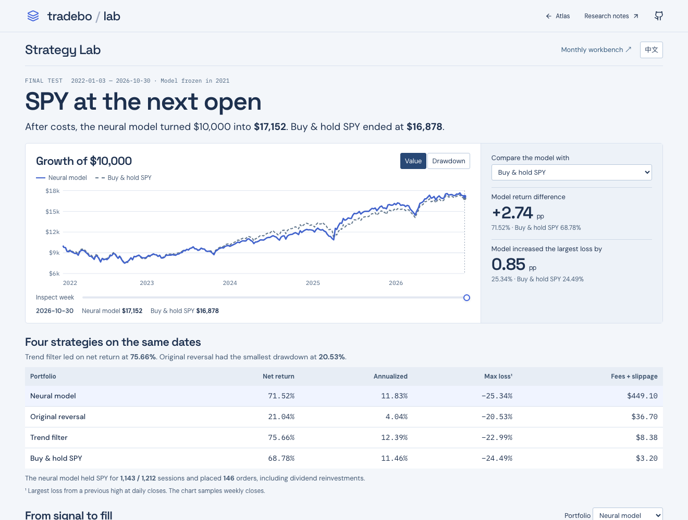

# SPY next-open study

Protocol `spy-open-1`. Freeze these choices before any strategy is scored on the final period. This extends the Lab from a monthly market index to one ETF with observed daily opens and closes.

## Dates and model

Use SPY from inception through October 30, 2026 (last completed calendar month at design time). Reconstruct close-to-close total returns from unadjusted-for-dividends prices and issuer distributions. Validate the session sequence against XNYS. The price source is [Yahoo Finance SPY daily history](https://finance.yahoo.com/quote/SPY/history/). Amounts, ex-dates and payable dates come from [State Street's distribution history](https://www.ssga.com/us/en/individual/resources/documents/etf-dividend-distributions). Use the issuer's distribution plus any capital gains. No raw vendor history is distributed with the site.

- The development walk-forward covers 2010–2021. Refit each January on the immediately preceding eight calendar years of mature examples. The final test starts at the first 2022 open and ends at the October 30, 2026 close. Fit once before that first open and freeze weights, preprocessing and threshold for the whole holdout. Historical market regimes have been studied elsewhere in this project. The holdout applies to this experiment's model development.
- At each close use trailing total returns over 1, 5, 21, 63 and 126 sessions, trailing 21-session sample volatility, today's dividend-inclusive overnight return, and today's open-to-close return. A binary label is positive if buying at the next open and holding to the following open delivers a positive gross return including intervening dividend entitlement. Both label endpoints must have occurred by the training cutoff. Scale features using training rows only.
- Two hidden ReLU layers of 16 and 8 units, logistic output, Adam, 30 epochs, batch size 64, learning rate 0.001, L2 alpha 0.0001, seed 42. Go long at probability ≥ 0.50, otherwise hold cash. Fix all settings in advance. No hyperparameter search, early stopping or selection by holdout results.
- Retain the original reversal's monthly clock. After a month-end close, hold equity if its trailing three-month total return is negative. For the trend filter, permit a fresh exit only when the current total-return index is at or below its trailing ten month-end mean. Carry vetoes until equity re-entry. Apply both signals at the following session's open. The neural model can change position daily. Buy-and-hold buys at the first test open. All four portfolios start the holdout from cash.

## Execution and endpoints

Each book starts with $10,000. Use fractional shares and zero interest on idle cash. Buy at the observed open plus 2 bp of slippage, sell at the open minus 2 bp. Charge 1 bp commission on executed notional. Buy only with available cash including the commission. Credit dividend entitlement to holders from the previous close on the ex-date. Count receivables in equity and release them to cash on the first trading session strictly after the payable date. Reinvest available dividends at a modeled open if the target is long. No shorting, leverage, taxes or forced final liquidation.

Mark to the observed close every trading day. Compute cumulative net return, calendar-time CAGR and maximum peak-to-trough drawdown on daily closing equity including the starting capital. Report model differences against each of the three baselines. Expose next-open receipts and separate modeled commission and slippage in dollars. Daily bars approximate a small market-on-open order. They contain no auction queue, bid/ask or actual broker fills.

Keep the holdout scoring command separate from training. Reconcile the published four portfolios, distributions, transaction costs and drawdowns independently. Show all outcomes, including losses to baselines.

## Final holdout

From January 3, 2022 to October 30, 2026 the model held SPY on 1,143 of 1,212 sessions. Its 146 orders include dividend reinvestments. Model commission totaled $149.70 and adverse fill slippage totaled $299.40. Net ending equity includes $42.76 in dividends due to the account at the final close.

| Portfolio               | Ending $10,000 | Net total return | Net CAGR | Maximum drawdown | Commission + slippage |
| ----------------------- | -------------: | ---------------: | -------: | ---------------: | --------------------: |
| Neural model            |     $17,152.35 |           71.52% |   11.83% |           25.34% |               $449.10 |
| Original reversal       |     $12,104.33 |           21.04% |    4.04% |           20.53% |                $36.70 |
| Trend-filtered reversal |     $17,566.41 |           75.66% |   12.39% |           22.99% |                 $8.38 |
| Buy and hold SPY        |     $16,878.39 |           68.78% |   11.46% |           24.49% |                 $3.20 |

The model gained 50.48 total-return points over original reversal and 2.74 over buy-and-hold. It trailed filtered reversal by 4.14 points. Its largest daily-close loss was deeper than all three, by 4.80, 0.85 and 2.34 points relative to original reversal, buy-and-hold and filtered reversal respectively. Peak and trough for the model were January 3 and October 12, 2022. These are historical outcomes on one instrument and one development-held-out period.

The 12 preceding rolling development folds cover 2010–2021. Continuous net CAGR / maximum drawdown were 13.58% / 22.64% for the model, 4.49% / 28.29% for original reversal, 14.55% / 33.69% for the trend filter and 14.92% / 33.69% for buy-and-hold. Development and final accounts each start separately with $10,000. The final model used 2,013 eligible training examples from January 2, 2014 through the December 29, 2021 signal. The last training label matured on December 31, 2021. The frozen model and scaler were committed in `ce2beb9` before scoring. The design was committed in `409ac0f`.

[](https://chencharl.github.io/Trade_bo/#lab)

## Where the 69 cash days went

This retrospective attribution (`spy-spells-1`) uses the same 1,212 sessions, frozen signals and fill rules as the final test. The 69 days form 64 continuous spells. Twenty-eight raised ending wealth by a combined $5,004.82. Thirty-six lowered it by $4,730.87. The difference, $273.95, is 2.74 percentage points of the initial $10,000.

| Exit open → re-entry open | Cash sessions | SPY declines avoided | SPY gains missed | Commission + slippage | Change in ending wealth |
| ------------------------- | ------------: | -------------------: | ---------------: | --------------------: | ----------------------: |
| Apr 3 → Apr 7, 2025       |             2 |               10.26% |            0.00% |                 $6.51 |              +$1,737.34 |
| Apr 8 → Apr 9, 2025       |             1 |                5.45% |            0.00% |                 $6.94 |                +$969.77 |
| Dec 18 → Dec 19, 2024     |             1 |                2.09% |            0.00% |                 $7.38 |                +$326.43 |
| Mar 21 → Mar 24, 2025     |             1 |                0.00% |            2.06% |                 $6.80 |                −$323.06 |
| Jan 25 → Jan 27, 2022     |             2 |                0.57% |            1.77% |                 $5.45 |                −$210.27 |

The model and buy-and-hold reached their largest drawdowns from January 3 to October 12, 2022. Six model exits occurred by that trough. The January 25, February 25 and July 6 exits deepened the maximum loss by 0.94, 0.46 and 0.63 percentage points in the chronological replay. The other three offset 1.18 points. The net effect was 0.85 points, taking drawdown from 24.49% to 25.34%. The large April 2025 gains came after that loss.

The trend filter sold on August 1, 2022 and bought back on September 1. SPY fell 3.97% between those opens, including the ups and downs along the way. Over the same interval the trend account returned −0.06% and the neural model returned −3.46%, both after costs. That single trend exit added $688.02 at the end of the test. Its worst drawdown was 22.99%, at the earlier June 16 trough.

| Ending wealth relative to holding SPY             | Neural model | Trend filter | Model minus trend |
| ------------------------------------------------- | -----------: | -----------: | ----------------: |
| Zero commission and zero slippage on all accounts |     +$944.52 |     +$698.74 |          +$245.77 |
| With the published trading costs                  |     +$273.95 |     +$688.02 |          −$414.07 |

Dollar differences use unrounded balances. Trading friction and the subsequent compounding of the smaller positions shifted the model–trend gap by $659.84. The modeled commissions and slippage charged over the entire test were $449.10 for the model and $8.38 for trend. Of the model costs, $445.91 came from its 64 exit/re-entry windows. The rest came from its first purchase and separate dividend reinvestments.

### How to read one exit

- **Market moves while in cash.** A spell runs from the sell at the open up to the buy at a later open. For one SPY share, each step is the next opening price minus today's opening price plus distributions earned at the next ex-date. Sum negative and positive moves separately, then divide both by the original exit price. Their difference describes holding that share over the window. A final open spell ends at the last close. The overnight drop before the exit and the intraday rebound after re-entry fall outside the window.
- **What both accounts earned.** Mark each portfolio immediately before any opening trade on the exit date and just after the trade on the re-entry date. This includes commissions, slippage, cash and any accrued dividend claims. Each side's window return uses its own starting wealth. The chart line uses daily closing net worth. Its dots mark exit dates and the shaded interval extends to the re-entry date.
- **Effect on the final balance.** Start with buy-and-hold, insert the first spell and replay the whole account. Add the second spell, replay again, and continue. The change from each preceding run is that spell's dollar contribution. Do the same with maximum drawdown and with zero costs. The differences telescope to the observed portfolio gap. Earlier changes affect the capital available for later trades, so the allocation of compounding to individual spells depends on this chronological order. These are retrospective contributions under the simulated execution assumptions.
- **Read the charts.** The upper chart uses trading dates. Each bar below it represents one exit in date order and the bar height gives its dollar effect on the ending balance. Select a dot, bar or date to inspect both portfolios. The year selector expands crowded periods. The JSON contains every spell and all four daily account paths.

[Download the attribution](../public/research/spy-spells.json) · [Inspect the chart](https://chencharl.github.io/Trade_bo/#lab)

## Reproduction

Use Python 3.12. The optional research dependencies have no effect on the browser app. Fetch the source files locally and retain the normalized input for future reproduction. The Yahoo chart request fixes both date endpoints. The State Street workbook is filtered to SPY within the same period. The 8,497 sessions match the XNYS calendar. All 136 issuer ex-dates match the vendor event dates. The study uses the issuer’s amounts throughout, including three 1990s amounts that differ by more than half a cent from the vendor events. Features use only locally accumulated past distributions.

```sh
python3.12 -m venv .venv-spy
. .venv-spy/bin/activate
pip install -r scripts/requirements-spy.txt
python scripts/spy_source.py /tmp/spy.csv
OPENBLAS_NUM_THREADS=1 python scripts/spy_study.py fit /tmp/spy.csv /tmp/spy-model.json
python scripts/spy_study.py score /tmp/spy.csv public/research/spy-model.json /tmp/spy-report.json
python scripts/verify_spy.py /tmp/spy.csv public/research/spy-model.json /tmp/spy-report.json --check-time
python scripts/spy_attribution.py /tmp/spy.csv public/research/spy-daily.json /tmp/spy-spells.json
python scripts/verify_spy_spells.py /tmp/spy.csv public/research/spy-daily.json /tmp/spy-spells.json
cmp /tmp/spy-spells.json public/research/spy-spells.json
```

The normalized CSV SHA-256 is `4e5edc91eca2a0a358e8d5bea7b20d6b3810642c3f2eb014fff9616936df94a1`. Input revisions trigger a hash mismatch. To use matching archived provider files, pass `--prices ORIGINAL_CHART.json --issuer ORIGINAL_DISTRIBUTIONS.xlsx` to the source command. The published [model artifact](../public/research/spy-model.json) and [report](../public/research/spy-daily.json) contain the fold returns, weights and training-only scaler, derived account values and simulated orders. Exact refit bytes may depend on numerical libraries. Using the published weights fixes the predictor across replays.

Independent verification uses scalar network inference and a 40-digit decimal portfolio ledger. It reconstructs holdings from prior-close features, marks overnight and intraday profits separately, and reconciles every order, fee, daily-close maximum drawdown, calendar result and weekly chart mark. The optional time check perturbs the future and recomputes the final fit and prior decisions. The screenshot and browser checks cover real-site navigation, bilingual results, all comparators, order selection and mobile layout.
