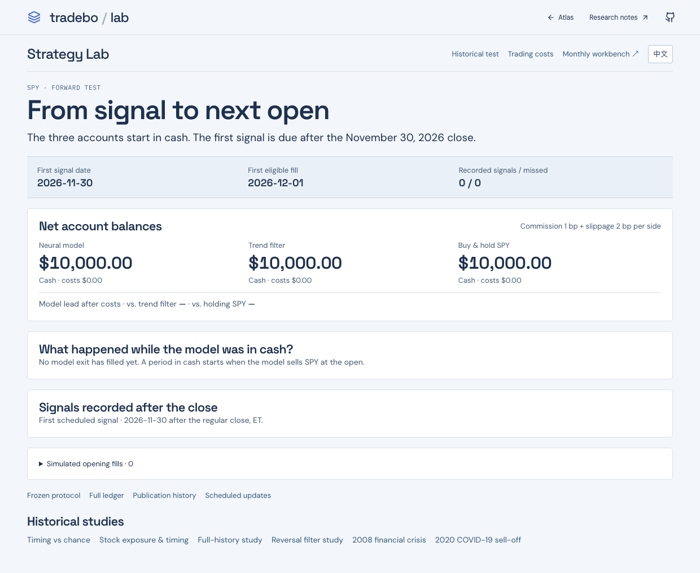

# SPY forward test

## Locked before the first signal

Protocol `spy-forward-1`. The first eligible signal is the November 30, 2026 close and the first eligible fill is the December 1 regular-session open. All three simulated accounts start with $10,000 in cash. The first annual review covers observations through November 30, 2027. Interim balances are descriptive.

Use the published `spy-open-1` weights and scaler (SHA-256 `782089554c0bc852fe2727b6e3ca17b006684456633df2f772cac27ce5f0d2ca`), its eight close-time features and 0.50 holding threshold. Use the existing monthly trend-filtered reversal rule with its historical state carried into the forward test. Hold SPY from the common first eligible open in the passive account. Preserve the original next-open execution, 1 bp commission on filled value, 2 bp adverse slippage per side, fractional shares, zero cash interest and distribution/payment treatment.

Use the XNYS session calendar in New York. Collect the model probability and each account’s next target after the regular close plus 20 minutes, by midnight local time that evening. Record the actual UTC observation time, the exchange close and the intended next regular open. Only a previously saved on-time signal can change active exposure at the next open. A missed signal is logged as missed. Both active accounts carry their position until another timely signal. The passive account's initial purchase was specified before launch.

An opening print can be observed after the scheduled open. Record both times. Use the first accepted observation of each phase and retain it across retries and subsequent price revisions. A late price can complete a mark or price an already authorized simulated order. Missing or conflicting prices, distributions or a split stop the update at that point.

For every model transition from SPY to cash, accumulate SPY declines avoided and gains missed between the exit open and re-entry open, including dividend entitlements. Divide both sums by the exit price. Mark an unfinished interval to the latest observed open or close. Compare all three accounts from immediately before the exit trade through just after re-entry, including both boundary costs. Report the total net dollar differences separately. Pre-entry idle cash is excluded from the exit count.

## Reading the live test

[Open the forward test](https://chencharl.github.io/Trade_bo/#lab-forward) in English or Chinese. The top row tracks recorded and missed signals. Below it, all three balances use the same starting capital, trading days and cost rules. A negative gap means the model trails that benchmark. Changes in the overall dollar lead include the effect of different balances going into an exit.

Select an exit to see the daily SPY declines avoided and gains missed. These are sums of the negative and positive open-to-open moves of one share, including distributions, divided by its exit price. For an open interval the last move runs to the latest available mark. Both numbers can be positive during the same exit. The return comparison starts each account from its own pre-sale balance and includes the cost of the sale and buyback. The dollar difference for a single exit scales this same-window return gap to $10,000. The journal links a signal to its recording run. The opening fills show prices, quantities, commissions and slippage.



## Automatic updates and audit trail

The updater reads regular-session SPY open and close prices from Yahoo Finance, checks ex-dates against State Street and uses the issuer’s amounts and payment dates. A source receipt records hashes of both responses and the time of the most recent regular market quote. The ledger stores price observations as an index based at 100 on November 27. Simulated fills display dollars per SPY share. Dividends enter the account as receivables on the ex-date and become spendable at the first regular open after the payment date. If a held account reinvests, the same trading costs apply. [State Street distributions](https://www.ssga.com/us/en/individual/resources/documents/etf-dividend-distributions)

GitHub Actions checks at 09:53, 10:27, 13:27, 16:27, 17:27 and 20:27 New York time on weekdays. The regular open and close come from the exchange calendar, including holidays and shortened sessions. The first close check on an ordinary day is scheduled for 16:27. GitHub can delay a scheduled run. Each receipt preserves the market time and the actual collection time. The page checks for a new ledger every five minutes and flags overdue observations. [NYSE hours and holidays](https://www.nyse.com/trade/hours-calendars) · [GitHub schedule behavior](https://docs.github.com/en/actions/reference/workflows-and-actions/events-that-trigger-workflows#schedule)

The first successful data check leaves an activation receipt, independent of the simulated accounts. The updater commits new observations on a dedicated branch and verifies that earlier events are unchanged before pushing. An outage that spans midnight leaves a missed signal. A new price fetch cannot authorize an order for a past open. [JSON ledger](https://raw.githubusercontent.com/Chencharl/Trade_bo/forward-data/ledger.json) · [Publication history](https://github.com/Chencharl/Trade_bo/commits/forward-data/) · [Run logs](https://github.com/Chencharl/Trade_bo/actions/workflows/spy-forward.yml)

## Reproduction

The frozen model, scaler, simulation engine, attribution code and pre-launch feature context have SHA-256 digests in the [launch record](../public/research/spy-forward-start.json). The context retains recent daily total-return levels and older month-end levels so the first signal uses the trained feature definitions and the established monthly trend state. The forward accounts begin in cash with a new clock and new capital.

With Python 3.12 in a virtual environment, run the deterministic tests and the optional historical rehearsal below. The rehearsal uses the original [SPY source snapshot](STRATEGY_SPY_DAILY.md#reproduction). Across 1,212 historical opens the prospective signal calculation reproduced every position for all three rules and their final balances. These observations stay out of the forward ledger.

```sh
python -m pip install -r scripts/requirements-forward.txt
python -m unittest discover -s tests -p 'test_spy_forward.py' -v
python scripts/verify_spy_forward.py /path/to/locked-spy.csv

curl -fsSL https://raw.githubusercontent.com/Chencharl/Trade_bo/forward-data/ledger.json -o ledger.json
python scripts/spy_forward.py ledger.json --verify-only
```
