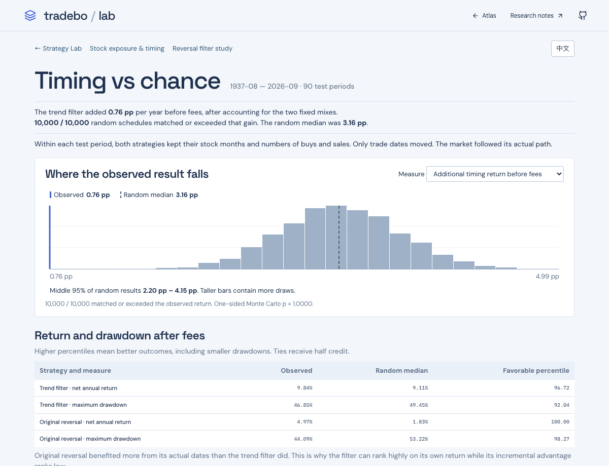

# Conditional timing test

Protocol `timing-null-1`. The known result is a gross annualized residual of 0.7603 percentage points after subtracting the gap between the two trailing fixed mixes in the [exposure study](STRATEGY_EXPOSURE.md). Freeze the following choices before inspecting the random schedules.

- Use the same pinned monthly U.S. equity and Treasury-bill returns, 90 test folds (including the last two months), 1,070 test months, opening cash, and 10 bp one-way fee. Carry wealth, peaks and positions across boundaries.
- In each fold, keep the incoming and final joint positions and every count of transitions between the three positions (both in cash, only the filtered rule in stocks, both in stocks). This fixes each rule’s invested months, buys and sales, including the boundary trade. A vetoed sale remains linked to an original cash spell. Enumerate all distinct admissible monthly schedules, including the observed one. Folds with only one arrangement stay fixed. Market returns keep their historical order.
- Draw uniformly from each fold independently, with replacement, for 10,000 paired full histories. Order candidate paths lexicographically in the state order above. Use unsigned big-endian 32-bit words from consecutive SHA-256 digests of ASCII `timing-null-1/20261125/<counter>`, starting at zero, with rejection sampling and no word consumed on singleton folds. The two lagged fixed mixes retain their published schedules. Conditioning on already observed fold counts defines a retrospective comparison.
- Primary endpoint is gross CAGR(filtered) − gross CAGR(original) − gross CAGR(filtered mix) + gross CAGR(original mix). Report the fraction of draws matching or exceeding the observed residual, and one-sided Monte Carlo p = (count + 1) / 10,001. For this endpoint and secondary net CAGR and monthly-close maximum drawdown of both strategies, publish 2.5%, 50% and 97.5% linearly interpolated quantiles, favorable midrank percentiles, and tie-inclusive counts. Higher return and shallower loss are favorable. Treat values within 1e−12 in fractional units as ties. Report the observed-minus-null-median residual as a descriptive comparison. It does not identify a causal fraction attributable to luck.
- As a separate execution sensitivity, apply each of the four observed target schedules one whole month later, including both controls. Start the first test month in cash and keep the same ending date, fees, and undisturbed chronology. Report net returns, drawdowns and the gross residual under both execution assumptions. The shifted schedules have their own trade counts and are outside the primary randomization.
- These are fixed trading rules on a revised historical index. This test fits no neural network and has no untouched post-selection test set. Market orders, spreads, partial fills and contemporaneous data releases are unobserved at monthly resolution. A predictive model would need dated available features, explicit labels and horizons, training-only preprocessing and model selection, chronological validation and a later untouched test before performance claims.

The plus-one convention follows [Phipson & Smyth](https://pubmed.ncbi.nlm.nih.gov/21044043/). [French series definitions](https://mba.tuck.dartmouth.edu/pages/faculty/ken.french/Data_Library/f-f_factors.html) describe the monthly inputs. [LEAN fill model documentation](https://www.quantconnect.com/docs/v2/writing-algorithms/reality-modeling/trade-fills/key-concepts) describes order-level quantities and prices for a more detailed execution model.

## Results

The observed gross residual was +0.7603 annual percentage points. All 10,000 paired random schedules equaled or exceeded it (one-sided p = 1.0000). The null median was +3.1597 points and the middle 95% was +2.1963 to +4.1473. Observed minus median was −2.3994 points. The median can differ from zero because fold-level exposures, trade counts and the market path are conditioned on, and the allocation contrast uses lagged controls. Twenty-six of the 90 folds had only one admissible paired schedule.

| Endpoint                           | Observed | Null median | Middle 95%       | Favorable percentile | Equal or better / 10,000 |
| ---------------------------------- | -------: | ----------: | ---------------- | -------------------: | -----------------------: |
| Gross timing residual, annual pp   |    +0.76 |       +3.16 | +2.20 to +4.15   |                 0.00 |                   10,000 |
| Trend filter net CAGR              |    9.84% |       9.11% | 8.24% to 9.89%   |                96.72 |                      328 |
| Trend filter maximum drawdown      |   46.85% |      49.45% | 45.88% to 54.38% |                92.04 |                    1,023 |
| Original reversal net CAGR         |    4.97% |       1.83% | 0.57% to 3.03%   |               100.00 |                        0 |
| Original reversal maximum drawdown |   44.09% |      53.22% | 44.56% to 67.69% |                98.27 |                      185 |

Both rules earned more on their observed dates than at their respective random medians. Original reversal improved more against its own timing control. The positive gross residual offers no evidence of superior incremental filter timing under this conditional comparison. These ranks describe one inspected U.S. history. The one-sided p-value measures extremeness under the specified null. The randomization cannot estimate the probability that any particular share of the gain was luck. Secondary return and drawdown ranks are descriptive.

## Execution sensitivity

| Portfolio          | Base net CAGR | Delayed net CAGR | Base max drawdown | Delayed max drawdown |
| ------------------ | ------------: | ---------------: | ----------------: | -------------------: |
| Trend filter       |         9.84% |           10.00% |            46.85% |               46.80% |
| Original reversal  |         4.97% |            5.54% |            44.09% |               41.62% |
| Trend fixed mix    |         9.96% |           10.01% |            47.56% |               47.55% |
| Original fixed mix |         6.03% |            6.06% |            22.78% |               22.83% |

Delaying all four targets one month changes the gross residual from +0.7603 to +0.3198 points per year. This sensitivity does not establish an executable latency or fill price. The source is a revised monthly aggregate. No model is trained during the conditional timing experiment. Fold occupancy counts and trade budgets are known after the fold and are used only to construct retrospective comparators. A live forecast must use information known at the decision timestamp.

[](https://chencharl.github.io/Trade_bo/#lab-timing-test)

## Reproduce

Use the [September 2026 input snapshot and hash](STRATEGY_EXPOSURE.md#reproduction) with Node.js 22.12+ and Python 3.10+.

```bash
npm ci
node --import tsx scripts/timing-null.mjs /path/to/archived.csv > /tmp/timing-null.json
npm run verify:exposure -- /path/to/archived.csv
npm run verify:timing -- /path/to/archived.csv
```

The runtime source enumerates walks through the observed transition counts in each fold. The independent Python verifier instead enumerates individual buy/sell masks, pairs eligible masks, and reproduces each distribution, histogram and tail count with fold-level compounding and cross-fold peak tracking. Both compare against the previous release’s observed portfolios. Only derived statistics are published. The protocol was recorded in commit `c6b72f5` before sampling.
